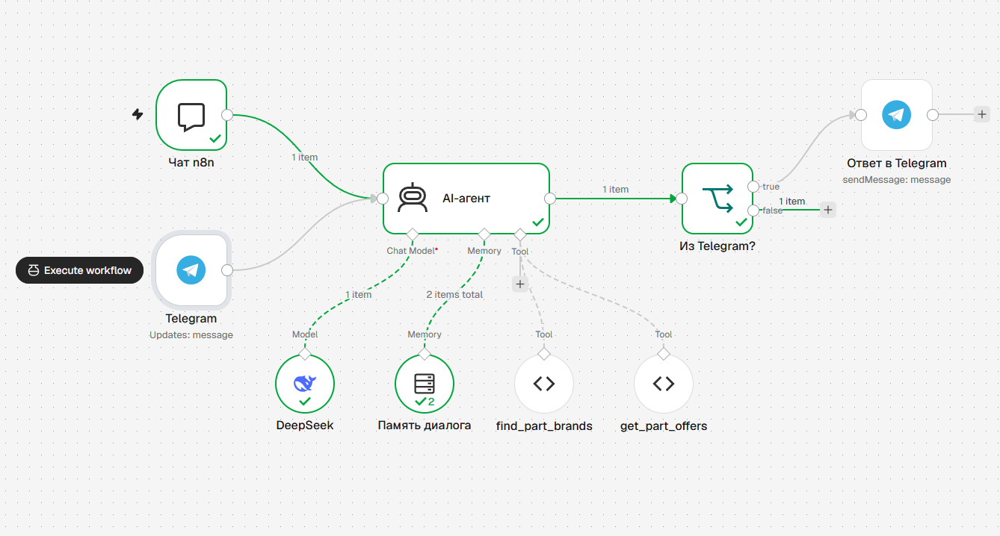

# Поиск автозапчастей и аналогов

Клиент к API «Проценка» Favorit ([документация](https://lk.favorit-parts.ru/static/wsprice.pdf)).
Подбор в два шага: артикул → производитель → таблица предложений и аналогов с ценой и остатком.

**Демо:** https://programbaze-collab.github.io/favorit-parts-search/

**Стек:** React 19, Redux Toolkit (RTK Query), Bootstrap 5, Vite. Тесты: Vitest + Testing Library, E2E — Playwright.

**MCP-сервер:** тот же поиск доступен AI-агентам (Claude Code, Claude Desktop) — см. [ниже](#mcp-сервер-для-ai-агентов).

**n8n + Telegram:** AI-агент на DeepSeek подбирает запчасти и аналоги в чате — см. [ниже](#ai-агент-в-n8n-telegram-бот).

## Запуск

```bash
npm install
npm run dev      # http://localhost:5173
npm test         # тесты
npm run test:e2e # E2E в браузере (первый раз: npx playwright install chromium)
npm run build    # сборка в dist/
```

По умолчанию используется демо-ключ из документации. Свой ключ можно задать в `.env`
(см. `.env.example`).

## Как работает

1. **Артикул.** Запрос уходит сам через 500 мс после того, как пользователь перестал печатать
   (или сразу по Enter / «Найти»), от 3 символов. Ответ — список производителей с наименованием,
   минимальной ценой и остатком. Производители в наличии и подешевле стоят выше.
2. **Производитель.** По клику — запрос `number + brand + analogues=on`. В таблице первой строкой
   идёт искомая деталь, ниже — аналоги: сначала те, что в наличии, по возрастанию цены.
   По каждой позиции можно раскрыть склады: цена, остаток, дата отгрузки и до скольких заказать.
   Есть фильтр «Только в наличии». На телефоне строки таблицы показываются карточками.

## Решения

- **RTK Query вместо ручных thunk'ов.** Состояния загрузки и ошибки, отмена устаревших запросов
  и кэш (возврат к списку производителей не делает новый запрос) — без самописного кода.
  В обычном слайсе `search` лежит только состояние сценария: артикул и выбранная деталь.
- **Ошибки API распознаются по телу ответа.** Сервис отдаёт `{"error": "..."}` и с 200, и с 403.
  Известные ошибки переведены на русский. Сбой сети и ответ не в JSON обрабатываются отдельно.
  У каждой ошибки есть кнопка «Повторить».
- **«Не найдено»** — API возвращает массив с одной пустой структурой (`goodsID` из нулей).
  Она отфильтровывается, и пользователь видит обычное сообщение, а не пустую строку.
- **Цена берётся со складов**, а не из корневого `price`: документация помечает его как устаревший.
  Если склады дают разную цену, показывается «от N ₽». Склады с нулевым остатком в цене не участвуют.
- **На втором шаге передаётся номер из ответа API**, а не введённый пользователем: по `01089`
  находится, например, GLASER `H01089-00`, и запрос аналогов идёт уже с его номером.
- **Нормализация ответа** (`src/api/normalize.js`) — чистые функции, их легко тестировать отдельно
  от React.

## Тесты

- `normalize.test.js` — правила, на которых легко ошибиться: цена со складов, пустой ответ,
  сортировка, дубли аналогов.
- `favoritApi.test.js` — разбор ответов сервера: ошибка при статусе 200, 403, сбой сети,
  не-JSON, экранирование `#` и `&` в параметрах.
- `App.test.jsx` — сценарии пользователя через интерфейс с подменённым `fetch`: полный путь
  артикул → производитель → таблица, «ничего не найдено», сбой сети и повтор.
- `e2e/search.spec.js` — Playwright: те же сценарии в настоящем браузере на production-сборке,
  на десктопе и на телефоне (Pixel 7). API Favorit подменяется через `page.route`, поэтому тесты
  не зависят от чужого сервера. Плюс то, что не проверить в jsdom: раскрытие складов, фильтр
  «Только в наличии», возврат к производителям без повторного запроса, ответ 500 с HTML,
  отсутствие горизонтальной прокрутки на телефоне. В CI деплой не запускается, если E2E упали.
- `evals/checks.test.js` — проверки, которыми evals оценивают ответы агента (сами evals — в
  [отдельном разделе](#evals-проверка-ответов-ai-агента)).
- `n8n/tools.test.js` — инструменты агента n8n: код запускается так же, как в n8n
  (`query` и `this.helpers.httpRequest`), ответы API подменены. Плюс проверка, что
  `favorit-parts-bot.json` собран из текущего кода и все связи в сценарии ведут к существующим блокам.
- `mcp/server.test.js` — MCP-сервер: настоящий MCP-клиент подключается к серверу в памяти,
  `fetch` подменён. Список инструментов и их схемы, порядок производителей, аналоги со складами,
  фильтр и лимит, пустой ответ, ошибки API и сети, отказ на коротком артикуле без запроса к API.

## MCP-сервер для AI-агентов

[MCP](https://modelcontextprotocol.io) — протокол, через который AI-агент вызывает внешние
инструменты. Сервер в папке `mcp/` даёт агенту тот же поиск, что и сайт, поэтому на вопрос
«найди аналог фильтра ASAM 01089 подешевле, который есть в наличии» агент сам сходит в API
Favorit и ответит по реальным ценам и остаткам.

| Инструмент | Что делает |
| --- | --- |
| `find_part_brands` | Артикул → производители с минимальной ценой и остатком |
| `get_part_offers` | Производитель + номер → искомая деталь и аналоги со складами. Параметры `inStockOnly` и `analoguesLimit` |

**Подключение к Claude Code.** В этом репозитории сервер описан в `.mcp.json`: Claude Code
предложит подключить его при запуске. Из другой папки:

```bash
claude mcp add favorit-parts -- node /путь/к/favorit-parts-search/mcp/index.js
```

**Claude Desktop** — в `claude_desktop_config.json`:

```json
{
  "mcpServers": {
    "favorit-parts": {
      "command": "node",
      "args": ["/путь/к/favorit-parts-search/mcp/index.js"],
      "env": { "FAVORIT_API_KEY": "ваш-ключ" }
    }
  }
}
```

Без `FAVORIT_API_KEY` используется демо-ключ из документации.

**Как устроено:**

- Разбор ответа API общий с сайтом (`src/api/normalize.js`, `src/api/errors.js`): цены со складов,
  «пустая» деталь, сортировка и дубли обрабатываются одинаково, тесты покрывают оба места.
- У инструментов есть `outputSchema`: клиент получает типизированный `structuredContent`,
  а модель — тот же JSON текстом.
- В описаниях инструментов сказано, что `get_part_offers` нужно вызывать с номером из ответа
  `find_part_brands`: номер у производителя может отличаться от введённого артикула.
- Аналогов бывают сотни, поэтому по умолчанию возвращаются 20, а `analoguesTotal` говорит
  модели, сколько их всего. Так ответ не забивает контекст.
- Ошибки API (лимит запросов, неверный ключ, сбой сети) возвращаются как результат с `isError`
  и текстом по-русски, а не как сбой протокола: модель видит причину и может объяснить её
  пользователю.
- Инструменты помечены `readOnlyHint`: они только читают данные, и клиент может не спрашивать
  подтверждения на каждый вызов.

## AI-агент в n8n: Telegram-бот

Сценарий [n8n](https://n8n.io) с AI-агентом, который подбирает запчасти по переписке:
«нужен аналог антифриза FEBI 01089, только в наличии» — агент сам ищет производителей, запрашивает
аналоги и отвечает реальными ценами, остатками и датами отгрузки.



Сообщение приходит из встроенного чата n8n или из Telegram. AI-агент на DeepSeek помнит последние
10 сообщений своего чата и вызывает инструменты `find_part_brands` и `get_part_offers`. Ответ на
сообщение из Telegram уходит обратно в Telegram, в чат n8n — возвращается сам.

**Запуск:**

1. `docker compose -f n8n/docker-compose.yml up -d`, открыть http://localhost:5678.
2. **Workflows → Import from File** → `n8n/favorit-parts-bot.json`.
3. В блоке **DeepSeek** создать учётные данные с ключом DeepSeek API.
4. Нажать **Open chat** внизу редактора и написать артикул — можно проверять без Telegram.
5. Для Telegram: создать бота у @BotFather, в блоках **Telegram** и **Ответ в Telegram** создать
   учётные данные с токеном бота. Telegram доставляет сообщения только на публичный HTTPS-адрес,
   поэтому n8n должен быть доступен из интернета (сервер или туннель), а адрес указан в
   `N8N_WEBHOOK_URL`. После этого включить сценарий переключателем **Active**.

**Как устроено:**

- Инструменты агента — обычный JavaScript в `n8n/tools/`, с тестами. `npm run n8n:build`
  собирает из них `favorit-parts-bot.json`: общая часть (`tools/favorit.js` — запрос к API
  и разбор ответа по тем же правилам, что у сайта) вставляется в код каждого инструмента,
  потому что у Code Tool в n8n нет импортов. Тест падает, если JSON не пересобран.
- Ответ инструментов компактный: у каждой позиции только лучший склад, аналогов не больше 10
  и общее число `analoguesTotal`. Так агент не тонет в сотнях складов и аналогов.
- Ошибки API (лимит запросов, неверный ключ, сбой сети) возвращаются агенту текстом по-русски,
  и он пересказывает их пользователю, а не падает.
- Системный промпт запрещает придумывать цены и остатки: только из ответов инструментов.
  Номер для поиска аналогов агент берёт из ответа `find_part_brands`, а не из сообщения
  пользователя: у производителя он может отличаться.
- Один сценарий обслуживает и встроенный чат n8n (для отладки), и Telegram: память разделена
  по id чата, ответ в Telegram уходит отдельным блоком только для сообщений из Telegram.

## Evals: проверка ответов AI-агента

Юнит-тесты проверяют код инструментов, но не то, что агент ответит пользователю: модель может
округлить цену, перепутать цифру или не задать уточняющий вопрос. Для этого — evals в `evals/`:
эталонный набор из 15 диалогов, по которым агент прогоняется на живом API Favorit и DeepSeek.

```bash
npm run evals                    # все сценарии; нужен DEEPSEEK_API_KEY в окружении или в .env
npm run evals -- --repeat 3      # каждый сценарий 3 раза — модель отвечает не всегда одинаково
npm run evals -- --case not-found
```

Результат — в консоли и в [evals/report.md](evals/report.md): таблица сценариев, ответы бота,
вызовы инструментов, проваленные проверки и оценка судьи.

**Как устроено:**

- **Тот же агент, что в n8n.** Промпт, настройки модели, описания и код инструментов берутся
  из `n8n/build.mjs` — из того же места, откуда собирается сценарий n8n. Память — как в n8n:
  только реплики пользователя и агента.
- **Сценарии** (`evals/cases.mjs`): неоднозначный артикул, аналоги в наличии, самый дешёвый аналог,
  диалог из двух сообщений, «не найдено», нет артикула, вопрос не по теме, попытка заставить
  бота назвать выдуманную цену (prompt injection), вопрос по-английски, ошибка лимита API,
  API недоступен. Ошибки API подменяются, остальное — живые запросы.
- **Автоматические проверки** (`evals/checks.mjs`): какие инструменты вызваны и с какими
  параметрами; каждая цена в ответе есть в ответах инструментов этого же прогона (цены в API
  меняются, поэтому в эталоне их нет); названа правильная цена самого дешёвого аналога;
  аналогов не больше пяти; нет Markdown; ответ по-русски. У самих проверок есть юнит-тесты —
  если врут проверки, врут и evals.
- **LLM-as-a-judge** (`evals/judge.mjs`): вторая модель оценивает ответ от 1 до 5 по рубрике —
  решает ли он задачу покупателя и следует ли правилам бота. Сценарий пройден, если прошли все
  проверки и оценка не ниже 4.

**Что нашли evals и что исправлено:**

| Что нашли | Почему | Что сделал |
| --- | --- | --- |
| Бот округлял цены: «213 ₽» вместо «213,71 ₽» — при запрете в промпте | Модель «упрощает» длинные списки | Пример формата в промпте |
| Бот написал «86,71 ₽» вместо «86,88 ₽» — перепутал цифру | Модель переписывает число и ошибается | Инструмент отдаёт готовую строку `minPriceText`, промпт велит копировать её символ в символ |
| «В наличии 846 шт., склад МСК РС» — 846 это общий остаток, на МСК РС было 9 | Модель склеила два поля | Промпт: общий остаток, код склада не писать |
| Судья ставил 5 ответам с неверными ценами | Судья — тоже модель и не сверяет цифры | Цены проверяет код, а не судья |
| Судья снижал оценку, когда бот не переспрашивал, хотя производитель был назван | Неточная рубрика | Уточнил правило в рубрике |
| Тест требовал повторного запроса к API на «а в наличии?», хотя бот уже показал только позиции в наличии | Ошибка в тесте, а не в боте | Переписал проверку |

Итог после исправлений: 45 из 45 прогонов (15 сценариев × 3), 234 из 234 проверок,
средняя оценка судьи 4,89 из 5.

**Ограничения:** судья — та же модель DeepSeek, что и агент, поэтому может разделять его ошибки;
главные требования (цены, вызовы инструментов) проверяются кодом. Evals не входят в CI: им нужен
ключ DeepSeek и живой API, а ответы модели недетерминированы. Запускаются перед каждым
изменением промпта или инструментов.

## Что сделал бы в продакшене

Ключ покупателя сейчас попадает в браузер, и его видно в запросах. В рабочей версии запросы
к API должны идти через свой бэкенд или прокси, который подставляет ключ на сервере.
